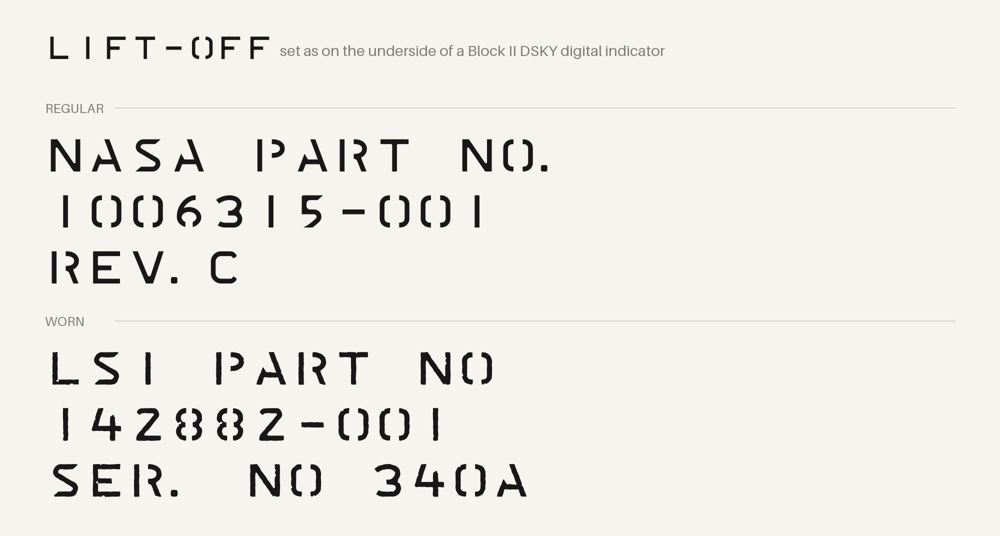
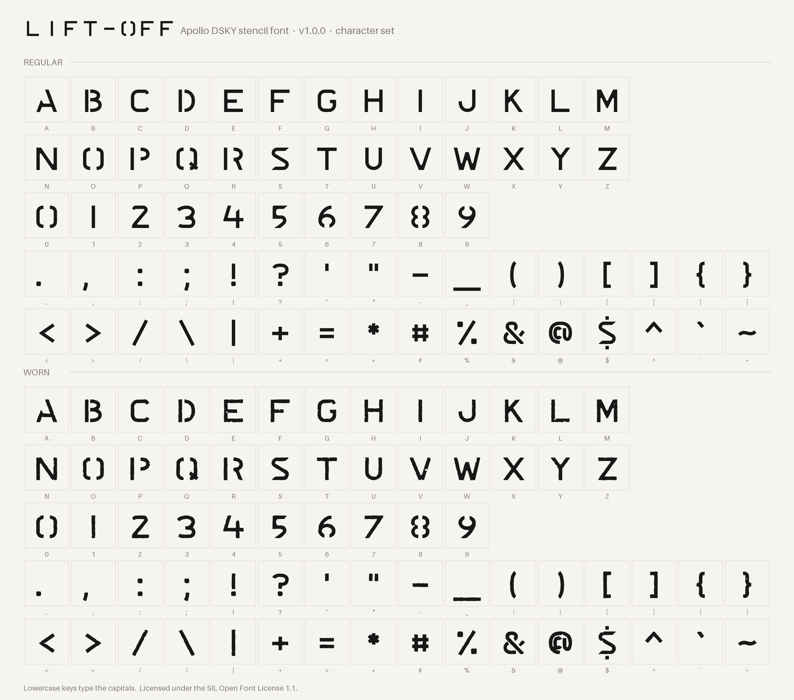

# Lift-Off

**An Apollo DSKY stencil font.** Lift-Off recreates the stencilled lettering found on Block II Apollo Guidance Computer and DSKY hardware: part numbers, serial numbers and revision marks. The name is a nod to both the Saturn V and the stencil itself, which has to be lifted off after use.

## Styles

| Style | Use it for |
|---|---|
| **Lift-Off Regular** | Clean outlines for documentation, drawings and diagrams |
| **Lift-Off Worn** | Paint bleed and wear for decals and markings on AGC and DSKY replicas |

## Download

Get the latest version from the [Releases](../../releases) page, or download the files in [`fonts/`](fonts/).

Install both `.otf` files the usual way for your system (double-click on macOS and Windows, or copy to `~/.local/share/fonts` on Linux).

## Matching real hardware

- **Size:** at **11.5 pt** the cap height is 0.112" and the character pitch is 0.143", matching the lettering on the underside of a Block II DSKY digital indicator.
- **Monospaced:** every character takes the same width, like the original stencil set.
- **Periods:** a period sits tight against the letter before it, and a space after a period closes up, so typing `REV. C` matches the hardware. Turn on stylistic set 1 (**ss01**, "Spaced period") in your app's OpenType or typography panel if you want a normal space after a period.
- **Lowercase:** lowercase keys type the capitals; the original stencils had no lowercase.
- **Hand-placed look:** the originals were stencilled by hand, so real units show small irregularities in spacing. Nudge individual characters in your drawing app if you are matching a specific unit.

## License

Lift-Off is licensed under the [SIL Open Font License 1.1](OFL.txt), with Reserved Font Name "Lift-Off".

You may use it freely in personal and commercial work, including printed, silk-screened or engraved markings and decals on products you sell. No credit is required on products. A mention in your build guide, kit instructions or product listing is appreciated.

You may not sell the font by itself. Modified versions must be renamed and stay under the OFL.

## Version history

See [CHANGELOG.md](CHANGELOG.md). Lift-Off uses [Semantic Versioning](https://semver.org/).

---

Lift-Off is a trademark of Firetooth. Designed by Craig Keithley.
